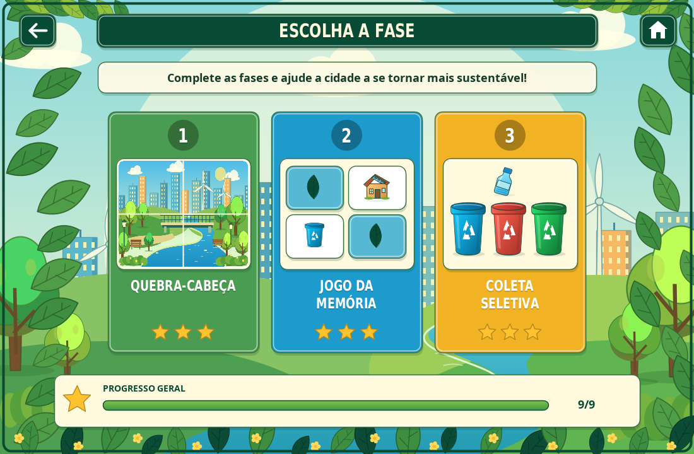

# IntelliGestor — Desafios Ambientais

Jogo educativo sobre sustentabilidade, feito inteiramente em **Java**, com **Swing e Java2D**. O cenário, o planeta com flores, os resíduos e as lixeiras são desenhados pelo próprio programa, sem imagens externas ou bibliotecas adicionais.



## Executar

Instale um JDK (Java 8 ou superior), abra o terminal na pasta do projeto e execute:

```bash
javac -encoding UTF-8 Main.java
java Main
```

É necessário um ambiente com interface gráfica para abrir a janela do jogo. Todo o código está em `Main.java`, incluindo as classes auxiliares `EcoArt` e `ItemArt`.

## Fases

1. **Quebra-cabeça:** troque duas peças por vez para montar a paisagem de nove peças.
2. **Jogo da memória:** encontre os seis pares em doze cartas.
3. **Coleta seletiva:** arraste os quatorze resíduos para as sete lixeiras corretas.

Complete uma fase para liberar a próxima. Use o mouse para jogar, a seta ou `Esc` para voltar e o botão de casa para retornar ao início. O progresso permanece durante a sessão. A janela pode ser redimensionada, com ajuste do desenho e das coordenadas do mouse.

## Resíduos e lixeiras

Os resíduos do código original foram preservados: jornal, garrafa, pote, lata, casca, pilha, lâmpada, caderno, sacola, vidro, latinha, banana, bateria e outra lâmpada.

| Lixeira | Cor |
| --- | --- |
| Papel | Azul |
| Plástico | Vermelho |
| Vidro | Verde |
| Metal | Amarelo |
| Orgânico | Marrom |
| Pilhas e baterias — coleta especial | Roxo |
| Lâmpadas — coleta especial | Turquesa |

## Validação

Compilado com Java 21. Interface renderizada em modo sem monitor. Coleta com os 14 resíduos e sete lixeiras; objetos exibidos somente como ilustrações, com os nomes mantidos nas lixeiras.
